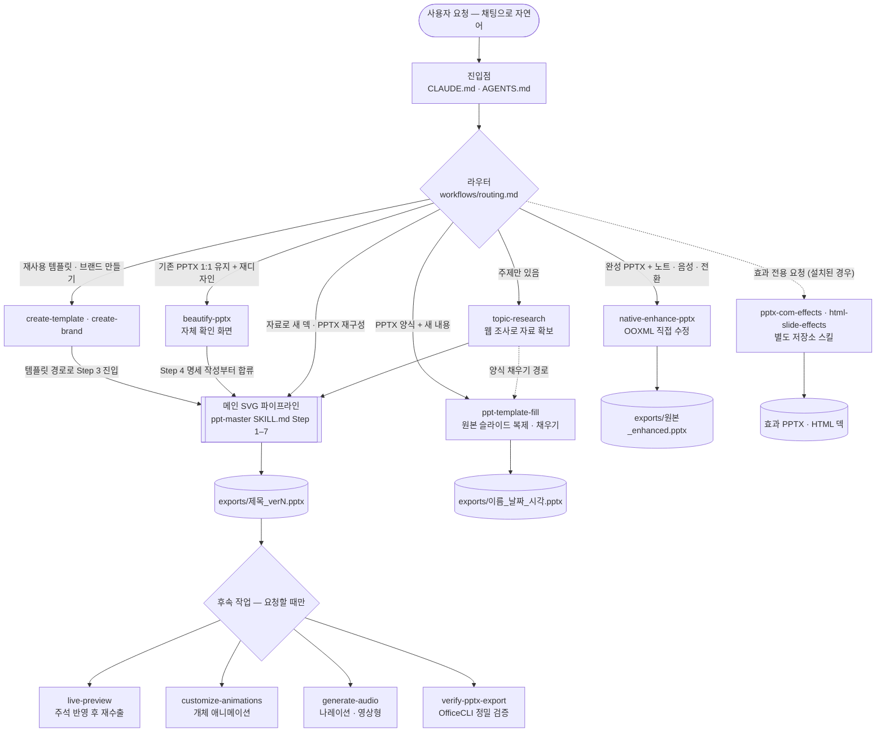
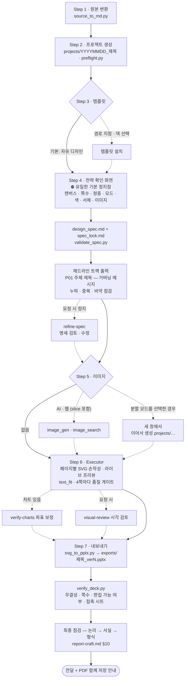

# Slide Master — 문서를 넣으면, PowerPoint에서 진짜 편집되는 PPT가 나옵니다

[-217346)](#faq)
[](#한글-폰트--pretendard-고정)
[](.claude/skills/ppt-master/references/canvas-formats.md)
[](LICENSE)

> 이 저장소는 [hugohe3/ppt-master](https://github.com/hugohe3/ppt-master)(MIT)를 기반으로 한 **장피엠 커스터마이즈 워크스페이스**입니다. 한국어 덱 제작에 맞춰 작업 절차(국내형 보고서 장표 규칙, 완료 PPTX 검증 워크플로우 등)가 조정·추가되어 있으며, 현재 [hanimuni/slide-master](https://github.com/hanimuni/slide-master)에서 관리합니다. 원 프로젝트의 라이선스와 저작권 고지는 그대로 유지합니다.

---

## 이게 뭔가요? (1분 요약)

- **무엇**: Claude Code, Codex(ChatGPT 데스크탑 앱 포함) 같은 AI 코딩 에이전트 안에서 도는 **PPT 생성 워크플로우(스킬)** 입니다. 별도의 앱이나 웹서비스가 아니라, 채팅으로 시키면 AI가 정해진 절차를 따라 내 컴퓨터에서 파일을 만들어 줍니다.
- **입력**: PDF · DOCX · 웹 URL · Markdown · 엑셀/CSV, 혹은 그냥 **주제 한 줄**
- **출력**: PowerPoint에서 **요소 하나하나 클릭해서 고칠 수 있는 네이티브 `.pptx`** — 도형·텍스트·차트가 이미지가 아니라 진짜 PowerPoint 개체입니다. 요청하면 발표자 노트, 페이지 전환, 음성 나레이션까지 담을 수 있습니다.
- **과정**: AI가 자료를 읽고 → 브라우저 확인 페이지에서 방향·디자인을 나와 함께 정하고 → 페이지를 SVG로 한 장씩 그린 뒤 → 자체 변환기로 PPTX를 만듭니다.

사용 예:

> "projects/에 넣어둔 3분기 보고서 PDF로 임원 보고용 PPT 만들어줘"

↓ (방향/디자인 확인 후 자동 진행)

```
projects/<YYYYMMDD>_<제목>/exports/<제목>_ver1.pptx   ← PowerPoint에서 바로 열어 편집 (재수출 시 ver2, ver3…)
projects/<YYYYMMDD>_<제목>/svg_output/                ← 페이지별 SVG 원본 (svg_final/ 미리보기는 요청 시에만 생성)
```

---

## 다른 AI PPT 도구와 뭐가 다른가요?

**PowerPoint에서 열어서 고칠 수 없으면 PPT가 아니다** — 이 워크플로우의 기본 철학입니다.

| 방식 | 결과물 | PowerPoint에서 요소별 편집? |
|---|---|:---:|
| 템플릿 채우기형 | 고정 템플릿에 텍스트만 채운 PPTX | 템플릿 한계 안에서만 |
| 이미지형 | 슬라이드 = 큰 그림 한 장 | ❌ 그림이라 못 고침 |
| HTML형 | 웹 기반 슬라이드 | ❌ PPTX가 아님 (웹 덱이 필요하면 별도 설치 스킬 `html-slide-effects`) |
| **네이티브 편집형 (이 프로젝트)** | **진짜 DrawingML 도형·텍스트·차트** | ✅ 아무 요소나 클릭해서 편집 |

- **비용이 투명합니다** — 도구는 무료·오픈소스이고, 드는 건 내가 쓰는 AI 모델 사용료뿐입니다.
- **데이터가 로컬에 남습니다** — AI 모델과의 통신을 빼면 전 과정이 내 컴퓨터에서 실행됩니다.
- **플랫폼에 묶이지 않습니다** — Claude Code, Codex(CLI · ChatGPT 데스크탑 앱), Cursor, VS Code Copilot 등에서 동작합니다.

> **만능 요술램프는 아닙니다.** 결과 품질의 천장은 모델이 정합니다(대용량 컨텍스트의 Claude 권장). 한 번에 완벽한 덱을 기대하기보다는 — 지루한 작업 대부분을 AI가 해오고, 마지막 다듬기는 편집 가능한 PPTX 위에서 직접 하는 도구라고 생각하면 정확합니다.

---

## 어떻게 동작하나요?

### 전체 워크플로우

요청은 먼저 **라우터**([`routing.md`](.claude/skills/ppt-master/workflows/routing.md))가 받아 하나의 경로를 고릅니다. 경로마다 담당 문서가 정해져 있고, 확인·검증·내보내기 규칙은 그 담당 문서가 정합니다.



### 메인 SVG 파이프라인 (Step 1–7)

기본 정지점은 **Step 4 확인 화면 한 번**뿐입니다. 그 뒤는 끝까지 자동으로 진행하고, 점선은 요청하거나 조건이 맞을 때만 지나는 길입니다.



### 장표 한 장의 구조 (국내형 보고서)

모든 본문 장표는 **주제형 제목 + 거버닝 메시지** 구조를 씁니다. 규칙의 원문은 [`report-craft.md`](.claude/skills/ppt-master/references/report-craft.md)입니다.

| 영역 | 들어가는 것 | 예시 |
|---|---|---|
| 머리 — 장 표시 · 스티커 | 목차 위치, 필요하면 우상단에 `예비` · `추정` · `논의용` | `Ⅱ. 추진 현황` · `[예비]` |
| 머리 — 주제형 제목 | 이 장이 다루는 주제 (결론을 쓰지 않음) | `Ⅱ-1. 제도 이용 실태` |
| 머리 — 거버닝 메시지 | 이 장의 결론 한 문장 (1줄, 계획한 경우만 2줄) | `○○제도 이용률 3년간 12%→5% 하락, 신청 절차 복잡성이 주원인` |
| 본문 | 거버닝 메시지를 빠짐없이(누락 0) · 남김없이(잉여 0) 뒷받침. 목록 4개 이하 · 항목당 2줄 이하, 차트는 강조 1색 + 회색 | 막대그래프 + 이슈 포인트 3개 |
| 바닥 | 왼쪽 출처, 오른쪽 덱 약칭 + 쪽 번호 | `출처: 자료명(연도)` · `분기별 사업 실적 · 03/12` |

| 단계 | 내가 하는 일 |
|---|---|
| 전략 확인 | 브라우저에 열리는 확인 페이지 **한 화면**(방향 · 디자인 시스템 · 이미지 섹션)에서 캔버스·페이지 수·색·폰트·이미지 방식을 고르고 한 번에 확정합니다. 색상 견본과 폰트 미리보기를 보면서 선택하고, 내장 덱 템플릿(맥킨지·애플·네이버 스타일 등)을 카드로 골라 시작할 수도 있습니다. 단계별 확인은 요청할 때만 씁니다 |
| 명세 직후 | 채팅에 출력되는 **헤드라인 트랙**(쪽별 주제 제목 — 거버닝 메시지)을 훑어봅니다. 고칠 곳이 있으면 바로 말하면 됩니다 |
| 생성 중 | 라이브 프리뷰로 슬라이드가 만들어지는 걸 실시간으로 보고, 고칠 부분은 화면에 클릭 주석으로 남겨 둡니다. 주석은 생성이 끝난 뒤 "주석 반영해줘"라고 하면 적용됩니다 |
| 완료 후 | `exports/`의 PPTX를 열어 확인합니다. 필요하면 채팅으로 "4페이지 차트를 막대로 바꿔줘"처럼 계속 다듬고, 배포 전에는 PowerPoint에서 PDF로도 저장해 둡니다 |

### 한글 폰트 — Pretendard 고정

SVG로 새로 그리는 덱(메인 파이프라인 · beautify)은 **Pretendard**(SIL OFL) 한 가족으로 통일됩니다(Step 3에서 설치한 템플릿이 자체 서체를 지정한 경우는 그 서체). 기존 PPTX를 직접 고치는 경로(template-fill · native-enhance)는 원본 서체를 유지합니다. 위계는 폰트를 바꾸는 게 아니라 굵기(Medium/SemiBold/Bold)와 크기로 만듭니다. 폰트 파일은 [`.claude/skills/ppt-master/assets/fonts/Pretendard/`](.claude/skills/ppt-master/assets/fonts/Pretendard/)에 번들되어 있습니다.

> PPTX는 폰트를 내장하지 않으므로, 만든 덱을 **다른 컴퓨터에서 열 때는 그쪽에도 Pretendard 설치**가 필요합니다.

---

## 설치 (10분)

**1단계 — Python 3.10+**

[python.org](https://www.python.org/downloads/)에서 설치할 때 **"Add to PATH" 체크** 필수. Windows는 [단계별 가이드](docs/windows-installation.md) 참고.

**2단계 — AI 에이전트**

[Claude Code](https://claude.ai/code)(CLI 또는 VS Code/JetBrains 확장) 권장 — 이 프로젝트가 가장 많이 검증된 환경입니다.

**Codex도 공식 지원합니다** — Codex CLI든 **ChatGPT 데스크탑 앱의 Codex**든, 이 저장소 폴더를 열기만 하면 됩니다. Codex용 실행 규칙([`AGENTS.md`](AGENTS.md))과 스킬 발견 스텁(`.codex/skills/`)이 저장소에 이미 포함되어 있어 별도 설정이 필요 없습니다.

그 밖에 Cursor, VS Code Copilot 등 파일 읽기/쓰기 + 명령 실행이 되는 에이전트라면 동작합니다.

**3단계 — 저장소 받기 + 의존성 설치**

```bash
git clone https://github.com/hanimuni/slide-master.git
cd slide-master
pip install -r requirements.txt
```

받은 폴더를 에이전트에서 엽니다 — IDE형이면 File → Open Folder, CLI형이면 `cd slide-master` 후 실행.

**4단계 (선택) — AI 이미지 생성**

표지·인포그래픽에 AI 이미지를 쓰려면 둘 중 하나:

```bash
# A) Codex CLI OAuth (API 키 불필요)
npm install -g @openai/codex
codex login

# B) API 키 — 환경변수 또는 .env에 OPENAI_API_KEY / GEMINI_API_KEY 등
```

**5단계 (선택, `ppt-template-fill` 경로는 필수) — 수출 PPTX 검증 도구**

내보낸 PPTX의 패키지 무결성·텍스트 넘침·렌더링을 자동 점검하려면 [OfficeCLI](https://github.com/iOfficeAI/OfficeCLI)를 설치합니다:

```bash
npm install -g @officecli/officecli@1.0.135
```

> Windows에 PowerPoint가 설치되어 있으면 검증 스크린샷이 **실제 PowerPoint 렌더링**으로 찍힙니다(가장 정확). 없어도 내장 렌더러로 동작합니다.

**6단계 (선택) — 효과 스킬 설치**

모핑·도형 병합·3D 같은 PowerPoint 고유 효과나 HTML 웹 덱이 필요하면 [hanimuni/slide-effects-skills](https://github.com/hanimuni/slide-effects-skills)의 두 스킬을 `.claude/skills/`에 복사합니다. 이 저장소에는 포함되어 있지 않으며 `.gitignore`로 제외됩니다.

```bash
git clone https://github.com/hanimuni/slide-effects-skills.git /tmp/slide-effects-skills
cp -r /tmp/slide-effects-skills/pptx-com-effects /tmp/slide-effects-skills/html-slide-effects .claude/skills/
python3 .claude/skills/ppt-master/scripts/sync_codex_stubs.py   # Codex 스텁 갱신
```

> `pptx-com-effects`는 Windows + 데스크톱 PowerPoint(COM), PowerShell, ffmpeg가 필요하고, `html-slide-effects`는 헤드리스 Chrome/Edge(검증 시 Playwright)가 필요합니다.

---

## 가장 흔한 사용 패턴

전부 채팅에 자연어로 말하면 됩니다 — 워크플로우 선택은 AI가 알아서 합니다.

| 상황 | 이렇게 말하면 | 내부 경로 |
|---|---|---|
| 자료로 새 덱 만들기 | "이 PDF(경로)로 PPT 만들어줘" | 메인 파이프라인 |
| 주제만 있고 자료가 없음 | "국내 이차전지 시장 동향 PPT 만들어줘" | 웹 리서치 후 메인 파이프라인 |
| 갖고 있는 PPTX 템플릿에 내용 채우기 | "이 템플릿 PPTX에 이 내용 채워서 만들어줘" | [`ppt-template-fill`](.claude/skills/ppt-template-fill/SKILL.md) 스킬 — 원본 디자인 그대로, SVG 안 거침, OfficeCLI 검증 루프 내장 |
| 기존 PPT를 페이지 그대로 예쁘게 | "이 PPT 문구/순서 유지하고 레이아웃만 개선해줘" | [`beautify-pptx`](.claude/skills/ppt-master/workflows/beautify-pptx.md) — 1:1 유지 |
| 완성 덱에 노트·나레이션·전환 추가 | "이 PPTX에 발표자 노트랑 음성 나레이션 넣어줘" | [`native-enhance-pptx`](.claude/skills/native-enhance-pptx/SKILL.md) 스킬 (이 저장소로 만든 덱이면 나레이션은 `generate-audio`, 전환은 `-t` 재수출) |
| 기존 PPTX + 새 자료 | "작년 덱이랑 올해 데이터로 올해 덱 만들어줘" | 라우터가 한 번 묻습니다 — 양식을 재사용(`ppt-template-fill`)할지, 내용만 참고(메인 파이프라인)할지 |
| PPTX/디자인을 재사용 템플릿으로 | "이 덱으로 재사용 템플릿 만들어줘" | [`create-template`](.claude/skills/ppt-master/workflows/create-template.md) |
| 내보낸 PPTX 품질 점검 | "수출된 PPTX 검증해줘" | [`verify-pptx-export`](.claude/skills/ppt-master/workflows/verify-pptx-export.md) — OfficeCLI로 스키마·넘침·렌더 확인 |
| 생성된 페이지 시각 자체 검토 | "페이지별로 시각 검토 돌려줘" | [`visual-review`](.claude/skills/ppt-master/workflows/visual-review.md) |
| PowerPoint 고유 효과 · 웹 덱 | "이 장표를 모핑으로 움직이게", "웹 슬라이드로 만들어줘" | 별도 설치 스킬 `pptx-com-effects` · `html-slide-effects` (설치된 경우) |

---

## 실전 시나리오

**A. 보고서 PDF → 임원 보고 덱**

```
projects/q3/sources/실적보고.pdf 로 10페이지 내외 임원 보고 PPT 만들어줘.
핵심 KPI 강조하고, 톤은 절제된 컨설팅 스타일로.
```

**B. 주제 한 줄 → 리서치 + 강의 덱**

```
"RAG가 뭔지 비개발자에게 설명하는 PPT" 만들어줘. 자료는 네가 조사해서.
```

**C. 회사 표준 템플릿 + 새 내용**

```
sources/회사표준템플릿.pptx 디자인 그대로 쓰고,
아래 붙여넣는 기획안 내용으로 채워줘. 안 맞는 페이지는 빼도 돼.
```

**D. 만든 덱 다듬기 → 재수출 → 검증**

```
(라이브 프리뷰에서 3페이지에 "간격 넓혀줘" 주석 남긴 뒤)
주석 반영해서 다시 내보내고, 수출본 검증까지 돌려줘.
```

---

## FAQ

**Q. 진짜 편집이 되나요, 그림을 PPT에 붙인 건 아닌가요?**

**A.** 진짜 편집됩니다. SVG를 DrawingML로 직접 변환하므로 텍스트 상자·도형·차트가 전부 네이티브 PowerPoint 개체입니다. 색·위치·문구 모두 PowerPoint에서 수정 가능합니다. 차트/표를 데이터가 연결된 진짜 PowerPoint 차트 개체로 뽑는 옵션(`--native-objects`)도 있습니다.

**Q. 결과가 마음에 안 들면요?**

**A.** 단계마다 안전망이 있습니다 — ① 생성 중 **자동 지오메트리 게이트**: 텍스트 겹침·캔버스 이탈·어색한 줄바꿈을 글리프 폭 산수로 검출해 AI가 스스로 수정합니다(플래그된 페이지는 픽셀 렌더로 한 번 더 확인), ② 수출 직후 **`verify_deck.py`(항상 실행)**: 무결성·쪽수·편집 가능 여부와 접촉 시트 점검, 이어서 논리 → 사실 → 형식 순 최종 점검, ③ 라이브 프리뷰 클릭 주석 — 생성이 끝난 뒤 "주석 반영해줘"로 적용, ④ 요청 시 페이지별 AI 시각 자체검토(`visual-review`)와 OfficeCLI 정밀 검증(`verify-pptx-export`). 그리고 최종 결과물이 편집 가능한 PPTX라서 언제든 직접 고칠 수 있습니다.

**Q. 우리 회사 템플릿/브랜드 컬러를 쓸 수 있나요?**

**A.** 네, 두 가지 방법으로요. 기존 PPTX에 내용만 채우는 건 `ppt-template-fill` 스킬(디자인 원본 유지), 브랜드 아이덴티티(색/폰트/로고)를 재사용 프리셋으로 만드는 건 create-brand/create-template 워크플로우입니다. 자세한 건 [템플릿 가이드](docs/templates-guide.md) 참고.

**Q. 비용은 얼마나 드나요?**

**A.** 도구 자체는 무료입니다. 드는 건 연결한 AI 모델 사용료뿐이고, 덱 분량·이미지 생성 여부에 따라 달라집니다. 모델 선택 팁은 [FAQ 문서](docs/faq.md) 참고.

**Q. 내 문서가 어딘가에 업로드되나요?**

**A.** AI 모델과의 대화에 들어가는 내용 외에는 전부 로컬에서 처리됩니다. 변환·생성·수출 스크립트는 모두 내 컴퓨터에서 실행됩니다.

**Q. 이 저장소는 어떻게 업데이트하나요?**

**A.** 업스트림([hugohe3/ppt-master](https://github.com/hugohe3/ppt-master)) 최신화가 필요하면 새로 받은 뒤 `projects/`와 로컬 커스텀을 옮기는 방식을 씁니다. 이 워크스페이스는 개인 커스터마이즈가 섞여 있어 단순 `git pull` 대상이 아닙니다. 이 저장소 사본은 `https://github.com/hanimuni/slide-master.git`에서 새로 받습니다.

---

## 폴더 구조

| 경로 | 내용 |
|---|---|
| [`CLAUDE.md`](CLAUDE.md) | AI 에이전트가 읽는 프로젝트 진입점 (라우팅 경계·폰트 정책) |
| [`AGENTS.md`](AGENTS.md) · `.codex/skills/` | Codex용 실행 규칙과 자동 생성 스킬 스텁 (`sync_codex_stubs.py`로 갱신, 손으로 고치지 않음) |
| [`.claude/skills/ppt-master/`](.claude/skills/ppt-master/) | 워크플로우 본체 — [`SKILL.md`](.claude/skills/ppt-master/SKILL.md)(절차 권위), `workflows/routing.md`(라우터)·`workflows/`(독립 워크플로우), `references/`(역할 정의·[`report-craft.md`](.claude/skills/ppt-master/references/report-craft.md) 보고서 장표 규칙), `scripts/`(변환·검사 도구), `templates/`(레이아웃·덱·브랜드·차트·아이콘) |
| [`.claude/skills/ppt-template-fill/`](.claude/skills/ppt-template-fill/) | 기존 PPTX 양식에 새 내용 채우기 (OOXML 직접 수정) |
| [`.claude/skills/native-enhance-pptx/`](.claude/skills/native-enhance-pptx/) | 완성 PPTX에 노트·음성·자동 넘김·전환 추가 |
| [`.claude/skills/diagram-design/`](.claude/skills/diagram-design/) | 다이어그램 장표 참고 라이브러리 (Executor가 읽음, 단독 실행 아님) |
| [`.claude/skills/codex-image/`](.claude/skills/codex-image/) | 단발 이미지 생성 (파이프라인 Step 5와 별개) |
| `.claude/skills/pptx-com-effects/` · `html-slide-effects/` | 선택 설치 효과 스킬 — [slide-effects-skills](https://github.com/hanimuni/slide-effects-skills)에서 관리, 이 저장소에서는 git 제외 |
| `projects/` | 내 작업 공간 — 프로젝트별 원본·SVG·수출 PPTX가 여기 생김 |
| [`docs/`](docs/) | 사용자 문서 (FAQ · 설치 · 기술 설계 · 템플릿 가이드) |

---

## 문서

| | 문서 | 내용 |
|---|---|---|
| 📘 | [Getting Started](docs/getting-started.md) | 첫 덱 만들기 3단계, 템플릿·프리뷰·애니메이션·나레이션 사용법 |
| 🪟 | [Windows Installation](docs/windows-installation.md) | Windows 단계별 설치 가이드 |
| ❓ | [FAQ](docs/faq.md) | 모델 선택, 비용, 레이아웃 문제 해결 |
| 🆚 | [Why PPT Master](docs/why-ppt-master.md) | Gamma·Copilot 등 다른 도구와의 비교 |
| 🏗️ | [Technical Design](docs/technical-design.md) | 아키텍처, 왜 SVG를 거치는가 |
| 🎨 | [Templates Guide](docs/templates-guide.md) | 브랜드/레이아웃/덱 템플릿 만들고 쓰기 |
| 🔊 | [Audio Narration](docs/audio-narration.md) | 음성 나레이션·자동 넘김 덱 만들기 |
| 📖 | [SKILL.md](.claude/skills/ppt-master/SKILL.md) | 핵심 워크플로우 규칙 (AI가 따르는 절차 원문) |
| 🧭 | [routing.md](.claude/skills/ppt-master/workflows/routing.md) · [index.md](.claude/skills/ppt-master/workflows/index.md) | 경로 선택 규칙 · 워크플로우 목록과 파일 이름 규칙 |
| 📝 | [report-craft.md](.claude/skills/ppt-master/references/report-craft.md) · [storyline-patterns.md](.claude/skills/ppt-master/references/storyline-patterns.md) | 국내형 보고서 장표 규칙 · 보고 유형별 스토리라인 골격 |

---

## 기술 스택

- **Python 3.10+** — 변환·검사·후처리 스크립트 전부
- **자체 SVG → DrawingML 변환기** — 래스터화 없이 네이티브 PPTX 생성
- **Pretendard** (SIL OFL) — SVG로 그리는 덱의 고정 폰트, 저장소에 번들
- **Playwright + Chromium** — 지오메트리 게이트의 선별 픽셀 확인·시각 검토용 페이지 렌더링 (선택 — 없으면 정적 검사만 동작)
- **OfficeCLI 1.0.135** — 수출 PPTX 스키마 검증·넘침 검출·렌더 확인 (선택, `ppt-template-fill` 경로는 필수)
- **Tabler / Phosphor / Simple Icons** — 내장 아이콘 라이브러리

## 라이선스

[MIT](LICENSE). 이 저장소는 [hugohe3/ppt-master](https://github.com/hugohe3/ppt-master) (MIT, Copyright © Hugo He)의 포크이며, 원 프로젝트의 라이선스 전문과 저작권 고지를 유지합니다. 아이콘·폰트 등 번들 자산은 각자의 라이선스(SIL OFL 등)를 따릅니다.

외부 저장소에서 가져와 개작한 스킬은 각 디렉토리에 업스트림 라이선스 전문을 동봉합니다. 선택 설치 효과 스킬(`pptx-com-effects` · `html-slide-effects`)은 이 저장소에 포함되지 않으며 [slide-effects-skills](https://github.com/hanimuni/slide-effects-skills)의 고지를 따릅니다.

- [`.claude/skills/codex-image/`](.claude/skills/codex-image/) — [wjb127/codex-image](https://github.com/wjb127/codex-image) 기반 (MIT, Copyright © wjb127)
- [`.claude/skills/diagram-design/`](.claude/skills/diagram-design/) — [cathrynlavery/diagram-design](https://github.com/cathrynlavery/diagram-design) 기반 (MIT, Copyright © Cathryn Lavery)
